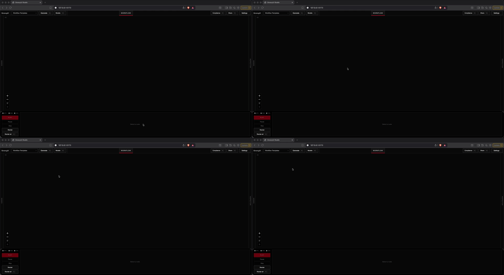
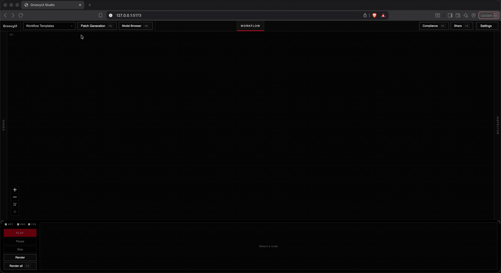
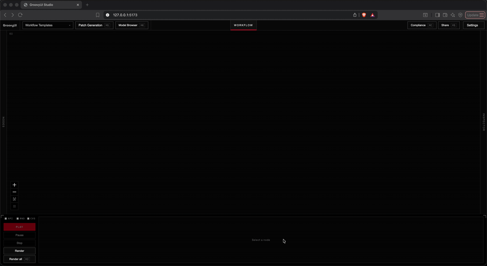

# GroovyUI

[-2026-111111?style=flat-square&labelColor=ff002b&color=111111)](https://ismir2026program.ismir.net/lbd_569.html#details)
[](https://www.youtube.com/@OneSystemics)

**Why GroovyUI?** Not a song button — additive AI audio you can patch, not a black box that finishes the take.

- **Use case:** first listen to what a model does on your material, then judge it against your spec.
- **Where:** quick evaluation between raw model repos and production DAWs. Explore here; arrange elsewhere.
- **Who:** people already comfortable with node-based tools (modular racks, Pure Data, Max/MSP).

<p align="center">
  
</p>

<p align="center">
  
</p>

<p align="center">
  
</p>

---

### YouTube

<table>
  <tr>
    <td align="center" width="50%">
      <a href="https://youtu.be/c7WwFqbLL8g"></a><br />
      <sub>Why GroovyUI?</sub>
    </td>
    <td align="center" width="50%">
      <a href="https://youtu.be/ctMC1M0kDV4"></a><br />
      <sub>GroovyUI — model browser and workflow suggestion</sub>
    </td>
  </tr>
  <tr>
    <td align="center" width="50%">
      <a href="https://youtu.be/jwZCArIzonQ"></a><br />
      <sub>GroovyUI — a patchbay for local AI audio exploration</sub>
    </td>
    <td align="center" width="50%">
      <a href="https://youtu.be/EkHTXhkB1fE"></a><br />
      <sub>GroovyUI — patch generation by LLM (Claude)</sub>
    </td>
  </tr>
  <tr>
    <td align="center" width="50%">
      <a href="https://youtu.be/2zjhSprhKII"></a><br />
      <sub>GroovyUI template — isolate to transcribe</sub>
    </td>
    <td align="center" width="50%">
      <a href="https://youtu.be/TEnSiojoloM"></a><br />
      <sub>GroovyUI template — prompt modular synth</sub>
    </td>
  </tr>
</table>

---

## Status

Experimental. APIs and UI will change. Expect rough edges on clean machines and first model installs.

## OS compatibility

Primary smoke-test machine: **macOS Tahoe 26.3** (Apple Silicon). Use **Python 3.11**, keep Inference on **Real** for demos, and install models via **Cmd+K** / Model Browser when prompted.

Video mux / PreviewVideo paths need **ffmpeg** on `PATH`. Some models need CUDA or other hardware; Mac CPU/MPS may be slow or unsupported depending on the backend.

Linux is exercised in CI (stub inference). Windows is not a supported desktop target yet.

## Quick start

```bash
# One-time install
uv venv --python 3.11
uv sync --all-packages --group dev
cd apps/studio && npm install && cd ../..

# Every session — API + studio + browser
./scripts/dev.sh
# or: just dev
```

Opens http://127.0.0.1:5173 (API on `:8188`). Ctrl+C stops both.

1. Settings → Inference → **Real** (Stub is for UI/CI only).
2. Pick a featured template (e.g. Hello Groovy or podcast denoise).
3. **Cmd+K** / **Ctrl+K** → install required models if prompted.
4. **Render** → play the cached preview.

If `./scripts/dev.sh` says port 8188 is in use, quit the leftover API (`lsof -nP -iTCP:8188 -sTCP:LISTEN`) and retry.

```bash
uv run pytest tests/ -q && cd apps/studio && npm test && uv run groovy-verify
```

Or with [just](https://github.com/casey/just): `just install`, `just test`, `just verify`, `just dev`.

## Cold machine

Cold / clean machines take longer on first run — `uv` sync, Studio `npm install`, and especially **first model downloads** (minutes, multi‑GB disk). Models keep their own licenses (see Compliance).

If a cold machine fails, check port `8188`/`5173` conflicts, disk space, Python version, and Compliance / Settings for tokens (`HF_TOKEN`) on gated weights.

### TTS with Emotion Editing

Template models: `kokoro-82m` + `step-audio-editx` (both Apache-2.0). Needs `uv` on `PATH` for the Apple Silicon sidecar. Without Apple Silicon or CUDA, use Settings → Inference → **Stub** for UI-only demos.

| Model | Platform | First-run expectation |
| --- | --- | --- |
| `kokoro-82m` | any | Lightweight TTS via Cmd+K.<br>Mandarin needs `misaki[zh]` extras (pulled with the model). |
| `step-audio-editx` | Apple Silicon | Bootstraps Python **3.13** sidecar (`uv` + `mlx-speech`).<br>Then ~**4 GB** MLX weights — often several minutes. |
| `step-audio-editx` | CUDA Linux | Upstream Step + **vLLM** (~12 GB VRAM).<br>Not a Mac path. |

Later Apple Silicon runs reuse `.groovy/models/step-audio-editx/`.

## License

[Apache License 2.0](LICENSE). Third-party models and weights keep their own SPDX licenses — the app license is not a grant to those weights.

Catalog requests from Studio (browser deep link, no GitHub token in the app): Model Browser → **File GitHub request**; Patch Generation → **Blueprint request** / **Node request**. See [CONTRIBUTING.md](CONTRIBUTING.md) and [SECURITY.md](SECURITY.md). Release notes: GitHub Releases.
